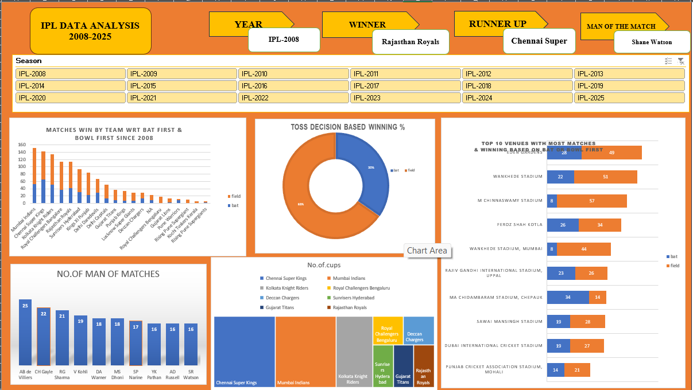

# IPL Data Analysis Dashboard 2008–2025

An Excel analysis of 1,169 IPL matches from 2008 to 2025 — winners, toss decisions, venues, and Man of the Match leaders — built with PivotTables and a dashboard view.

## What this analysis answers

- Who wins the IPL most often, and who wins the toss most often?
- Does winning the toss and choosing to bat or field actually help?
- Which players win Man of the Match most often?
- Which venues host the most matches?

## Key findings

- **1,169 matches** analysed, seasons 2008–2025, across 18 seasons
- **Most titles: Chennai Super Kings and Mumbai Indians, 5 each**, followed by Kolkata Knight Riders with 3
- **Toss decision matters:** teams that won the toss chose to field in **764 matches (65.4%)** and to bat in **405 matches (34.6%)**
- **Man of the Match leaders:** AB de Villiers (25), Chris Gayle (22), Rohit Sharma (21), Virat Kohli (19)
- Match-level data covers team, season, date, toss winner, and toss decision for every match

## Tools used

- **Microsoft Excel** — PivotTables, formulas, and dashboard design
- **Data Analysis** — match-level aggregation by season, team, venue, and player

## Files

| File | Description |
| --- | --- |
| `ipl-data-analysis-dashboard.xlsx` | The complete Excel workbook — `IPL Info` (1,169 matches), PivotTables by winner, toss, venue, and player, plus the `DASHBOARDS` sheet |
| `ipl-dashboard.png` | Dashboard screenshot |

## How to open it

1. Download `ipl-data-analysis-dashboard.xlsx`
2. Open it in Microsoft Excel
3. Start on the `DASHBOARDS` sheet, then explore the PivotTables and the `IPL Info` data

## About me

**Dinesh Karthik** — Aspiring Data Analyst | SQL · Power BI · Python · Excel

Final-year B.Tech Computer Science student, graduating 2027, seeking entry-level Data Analyst roles in India.

- LinkedIn: https://www.linkedin.com/in/dinesh-karthik-732a882bb/
- Portfolio: https://portfilo-lime-two.vercel.app/
- GitHub: https://github.com/dineshkarthik14322
